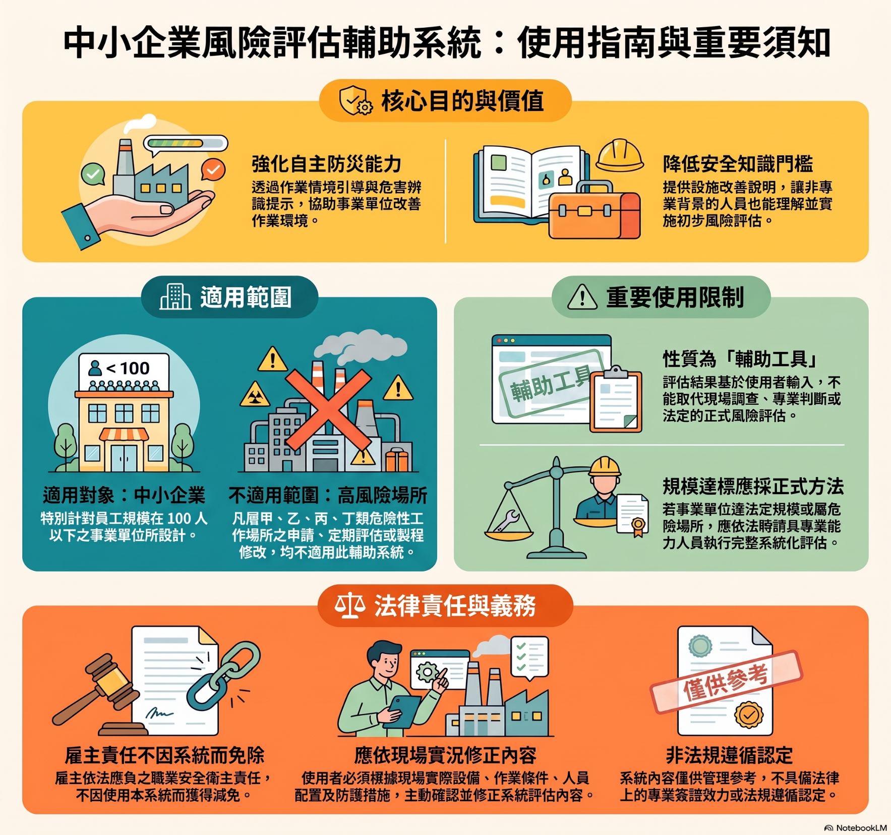
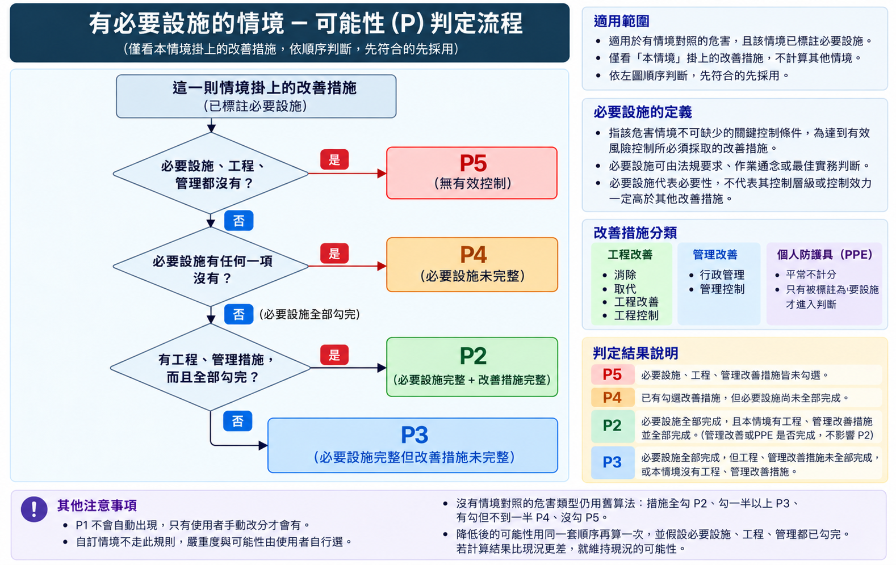
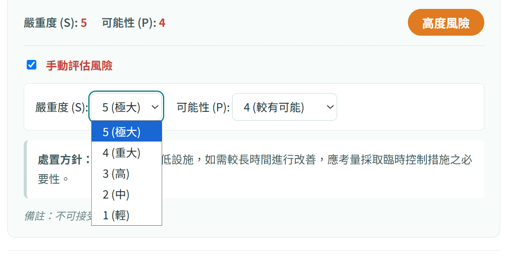
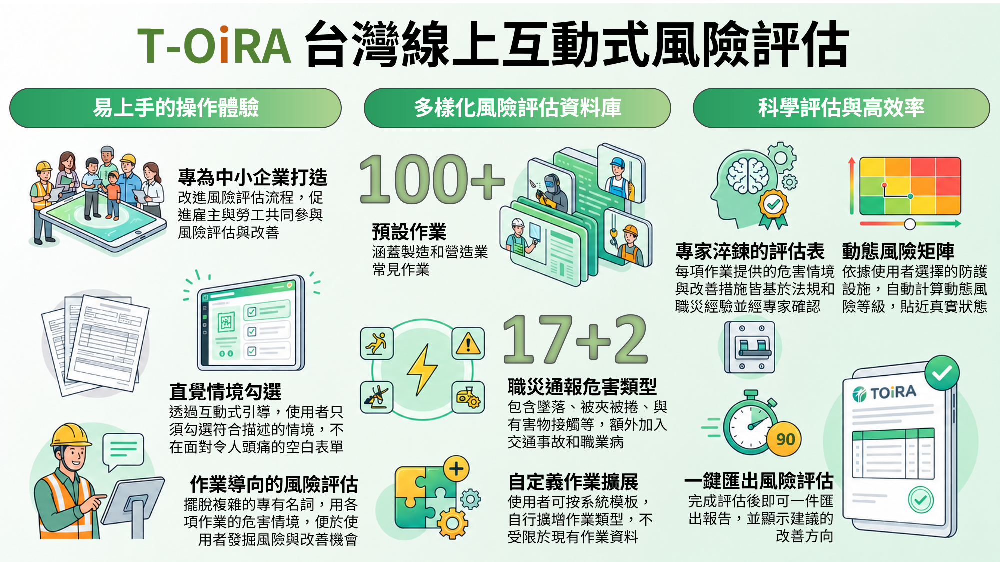
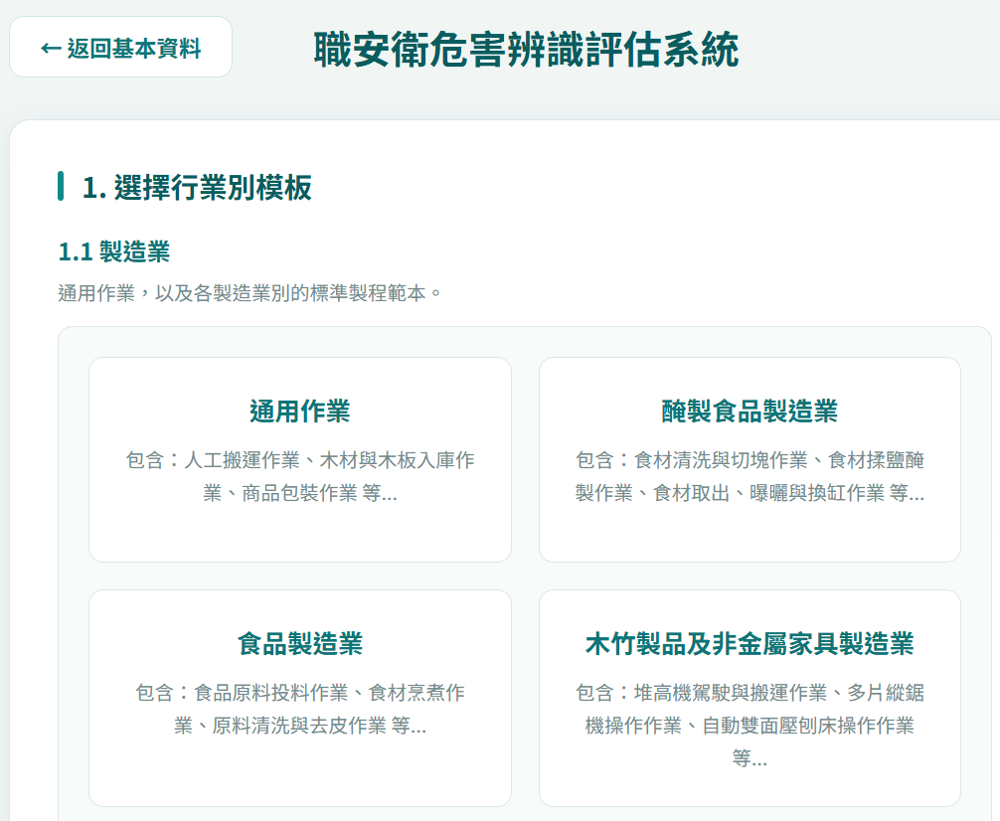
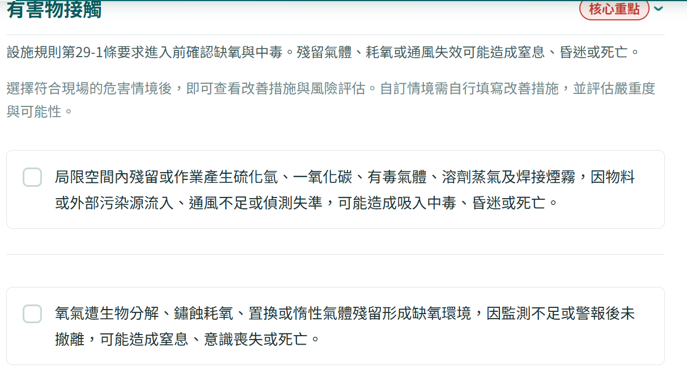

# TOIRA 常見問答｜文字細修稿

版本：2026/10/11。下列問答已同步至原型；修改本檔後仍需同步回網站。

## 使用方式

### Q1. TOIRA 是什麼？適合誰使用？

TOIRA 是台灣線上互動式風險評估輔助工具，以常見作業的具體危害情境，引導使用者確認現有防護措施與應採取之預防設施，協助進行初步、定性的風險評估。

主要協助中小企業與自營作業者降低評估門檻。以員工 100 人以下、較缺乏風險評估專業資源的事業單位為設計重點；仍應由具相關能力的人員依現場條件覆核。

複雜且高風險的作業場所，以及須辦理危險性工作場所申請、定期評估或製程修改的情況，應另依適用要求完成系統化評估。

圖解：使用指南與重要須知

圖卡中的 100 人以下為產品設計重點；是否須採完整法定評估，仍應依事業規模、危害性質及適用要求確認。

### Q2. 如何開始評估一項作業？

填寫公司資料後，依行業挑選作業，或自行從資料庫加入符合現場的項目。評估流程如下：

1. 確認作業範圍與實際設備、材料及人員配置。
2. 選擇符合現場的危害情境，並補充未涵蓋的危害。
3. 勾選已備有且實際有效落實的防護措施。
4. 檢視系統風險等級與應採取之預防設施；若手動調整，補上現場依據與備註。
5. 確認評估內容後儲存專案，匯出 Excel 或 PDF 報表，並追蹤改善完成情形。

### Q3. 找不到符合現場的作業或危害，怎麼辦？

可使用資料庫關鍵字查詢，或新增自定義製程、危害情境及預防設施。

自訂情境不自動評分，應自行選擇嚴重度與可能性，並由具相關能力的人員確認；未評分者在報表中顯示「未評估」。

### Q4. 公版內容如何由專家把關？

公版作業資料於建置階段使用 AI 輔助撰寫，須經專家逐筆審查後，才提供正式查詢與評估使用。

審查重點包括作業範圍、危害情境、預防設施、法規與實務的適切性，以及風險分級的合理性。使用者仍須依現場設備與作業條件確認及修正。

## 風險分級

### Q5. 風險等級是由 AI 即時計算的嗎？

風險等級由固定的 5×5 嚴重度 S／可能性 P 矩陣查得。一般評估、QA 查詢與報表匯出均不呼叫 AI。

嚴重度的參考資料與現場措施勾選共同影響結果；風險等級不是現場事故機率的實測值。

### Q6. 嚴重度開關開啟、關閉有何不同？

原型保留比較開關。關閉時採生成時的情境估算；開啟時採 110–114 年（5 年）職災統計與分級規則，公版參考等級為 S2–S5。

立即危險類型採 S5；職業病可恢復採 S4、不可恢復採 S5。

切換開關不會覆寫使用者已設定的手動評估。報表會標示當次嚴重度來源。

### Q7. S5 是否代表現場一定有立即危險，必須停工？

S5 是本工具的後果嚴重度分級，不等於現場已符合法定的立即危險情事。

認定標準列出墜落、感電、倒塌崩塌、火災爆炸及中毒缺氧等類型；是否有立即危險，仍須依各類型的法定具體情事與現場防護判斷。

現場確有立即危險時，應即停止相關作業並退避，不得等待矩陣評分或改善期限。

立即發生危險之虞認定標準第 2 條｜條文全文

有立即發生危險之虞之類型如下：
一、墜落。
二、感電。
三、倒塌、崩塌。
四、火災、爆炸。
五、中毒、缺氧。

[官方法規](https://laws.mol.gov.tw/FLAW/FLAWDOC01.aspx?flno=2&id=FL022800)
查核日期：2026/10/11。

### Q8. 職業病的 S4、S5 如何區分？

本次分級規則為可恢復的職業病採 S4，不可恢復的職業病採 S5。

同一情境若含多種健康後果，應依較嚴重的合理可預見後果評估。可恢復性應由具職業衛生或職業醫學能力的人員確認。

職業病的風險分級供危害辨識使用，不能視為醫療診斷。

### Q9. 勾選防護措施後，可能性如何改變？

有情境對照且標示必要設施時，只看這一則情境所對應的措施，依下列順序判斷，先符合的條件先採用：

1. P5：必要設施、工程及管理措施都未落實。
2. P4：已落實部分措施，但仍有任一必要設施未完成。
3. P2：必要設施全部完成，且該情境有工程措施、工程措施也全部完成。
4. P3：必要設施全部完成，但工程措施未全做，或該情境沒有工程措施。

必要設施可以分屬工程、管理或個人防護；只要標示為必要，就納入是否完成的判斷。一般管理措施及未標示必要的個人防護具，不會改變上述 P2 的判定條件。

有情境對照但未標示必要設施時，依工程／管理措施完成狀況分級，系統自動評分最低為 P3。無情境對照時則按公版措施勾選比例：全做 P2、至少一半 P3、有做但不足一半 P4、未做 P5。

P1 不會自動出現，只能由使用者手動評估。措施須確實有效落實，不能為了降低分數而勾選尚未完成的項目。

圖解：必要設施情境的可能性判定流程

P2 以必要設施完整且工程措施全部完成為條件；一般管理措施或未標必要的個人防護具不影響此條件。判定順序詳見上方文字。

### Q10. 「預估處理後之風險」可以當作改善完成證明嗎？

不可以。該欄假設應採取的措施已完整落實且有效，用於預估處理後的風險。

改善完成後仍應確認設備、措施與人員執行狀況，留下查核與驗收紀錄，再重新評估現場風險。

## 改善與責任

### Q11. 「現有(已備有)防護措施」應如何勾選？

僅勾選現場已備有、正在使用且有效落實的措施。尚在採購、排程、規劃或承諾中的措施，應保留為待改善。

勾選是一項現況紀錄，不能取代現場查核與執行證據。

### Q12. 「應採取之預防設施」未完成會被處罰嗎？

雇主應依實際危害與適用法令實施風險評估，並採取必要的預防設備及措施；本工具的勾選或分數不會免除這項義務。

是否違法或受裁罰，須依未落實的事項、適用法條與現場事實認定。不是按下勾選就自動產生一項新的罰則，也不能以取消勾選規避原有義務。

請將必要設施列入改善計畫，確認負責人、期限、暫時防護與完成查核。

職業安全衛生管理辦法第 12 條之 1｜條文全文

雇主使勞工從事工作前，應就工作場所內之建築物、機械、設備、器具、原料、材料等或作業活動及其他可能引起之危害因素實施風險評估，並依評估結果，採取必要之預防設備及措施。

雇主應依其事業單位之規模、性質及前項風險評估結果，訂定職業安全衛生管理計畫，要求各級主管依其職責指揮、監督所屬人員執行；勞工人數未滿三十人之事業單位，得以安全衛生管理執行紀錄或文件代替職業安全衛生管理計畫。

勞工人數在一百人以上之事業單位，應另訂定職業安全衛生管理規章。

第二項職業安全衛生管理計畫，應包括下列事項：
一、機械、設備或器具之管理。
二、危害性化學品之分類、標示、通識及管理。
三、有害作業環境之採樣策略規劃及監測。
四、危險性工作場所之製程或施工安全評估。
五、採購管理、承攬管理及變更管理。
六、安全衛生作業標準。
七、定期檢查、重點檢查、作業檢點及現場巡視。
八、安全衛生教育訓練。
九、個人防護具之管理。
十、健康檢查、管理及促進。
十一、安全衛生資訊之蒐集、分享及運用。
十二、緊急應變措施。
十三、職業災害、虛驚事故、影響身心健康事件之調查處理及統計分析。
十四、安全衛生管理稽核及績效評估措施。
十五、其他安全衛生管理措施。

第二項職業安全衛生管理事項之執行，應作成紀錄，並保存三年。

[官方法規](https://law.moj.gov.tw/LawClass/LawSingle.aspx?pcode=N0060027&flno=12-1)
查核日期：2026/10/11。

### Q13. 使用者可以自行調低風險等級嗎？

原型提供手動評估，應依現場事實填寫「調整理由／備註」，說明措施有效性與調整依據。

自行調降者應承擔其調整及作業決策責任。調低分數不代表現場危害已降低，亦不免除法定安全衛生與防護義務。

手動調整的現況值與預估處理後之風險，以及調整說明，會在報表中以紅色標示。

圖解：手動評估操作示意

實際調整時須依現場事實補上調整理由／備註，並確認報表中的手動標記。

### Q14. 現場有立即危險時，應先填表還是先處置？

應先停止相關作業並使勞工退避至安全場所，再依現場程序處置與報告。不得等待填表、評分或改善期限。

勞工執行職務發現立即危險時，得在不危及其他工作者的情況下自行停止作業及退避，並立即向直屬主管報告。

職業安全衛生法第 18 條｜條文全文

工作場所有立即發生危險之虞時，雇主或工作場所負責人應即令停止作業，並使勞工退避至安全場所。

勞工執行職務發現有立即發生危險之虞時，得在不危及其他工作者安全情形下，自行停止作業及退避至安全場所，並立即向直屬主管報告。

雇主不得對前項勞工予以解僱、調職、不給付停止作業期間工資或其他不利之處分。但雇主證明勞工濫用停止作業權，經報主管機關認定，並符合勞動法令規定者，不在此限。

[官方法規](https://law.moj.gov.tw/LawClass/LawSingle.aspx?pcode=N0060001&flno=18)
查核日期：2026/10/11。

## AI 與資料

### Q15. 平台在哪個階段使用生成式 AI？

本平台於作業資料建置階段，使用生成式人工智慧輔助撰寫。作業資料須經專家審查後，才提供正式查詢與評估使用。

使用者操作時的風險計算、QA 查詢及報表匯出，採固定規則及既有內容；使用者填寫的資料不提供 AI 讀取，也不用於 AI 再次訓練。

### Q16. AI 訓練會不會使我填寫的資料外洩？

使用者填寫的資料與評估作業不提供人工智慧讀取，也不會用於人工智慧再次訓練。

一般評估、QA 搜尋與 Excel／PDF 匯出均在瀏覽器處理，不把填答送交後端模型。

仍請妥善管理裝置、帳號與匯出檔案，避免在共用電腦留下公司資料；不使用 AI 不等於所有資訊安全風險均已消失。

### Q17. 填答及評估作業會被如何保存與分析？

使用者填寫的資料與評估作業，保留供匿名化之描述性分析使用，例如了解作業類型、防護措施落實情況及風險等級分布；不提供 AI 讀取或再次訓練。

分析前應去除或處理公司名稱、統一編號、聯絡資訊及備註中的可識別內容，並避免由稀少案例辨識特定事業單位或個人。

### Q18. QA 查詢會將問題送給 AI 嗎？

不會。QA 只搜尋本頁已整理的固定問答內容，支援關鍵字與分類篩選，不會將搜尋內容送交 AI。

可輸入多個關鍵字或題號（例如 Q13）；若沒有結果，可清除搜尋或切換全部分類。

## 報表與保存

### Q19. 評估資料如何儲存？可以換裝置接續嗎？

按「儲存評估」後，專案保存在目前瀏覽器；公司資料亦可能保留於同一瀏覽器。清除網站資料或更換裝置、瀏覽器，可能無法取得原專案。

原型尚未提供跨裝置同步，請匯出報表保留紀錄。共用電腦使用後，應依單位規範管理或清除留存資料。

### Q20. 匯出的報表可以直接作為法規符合證明或自動申報嗎？

報表供初步危害辨識、內部管理與改善追蹤參考，不能單獨保證現場安全、符合法令或已完成法定評估程序；本平台也不會自動申報。

可下載 Excel 供事業單位修改內文，或匯出 PDF。每則選取的危害情境會呈現對應的現有防護、風險評估、應採取之預防設施與預估處理後之風險。

目前報表欄名為「現有(已備有)防護措施」及「應採取之預防設施」。手動調整的現況與處理後風險值，以及調整說明，均以紅色標示。

請先由具相關能力的人員確認內容，再依適用要求保存及辦理後續作業；預估處理後的分數仍須經改善查核與驗收確認。

## 功能與資料來源

### Q21. TOIRA 與傳統填寫風險評估表有何不同？

傳統方式需要使用者從作業中辨識危害、判斷風險並提出對策。TOIRA 先提供常見作業、具體危害情境與預防設施，讓使用者依現場逐項確認。

使用者可從行業模板開始，再挑選作業、危害情境與現有防護措施。系統依填答呈現風險及待改善項目，協助雇主與勞工共同參與評估。

現場調查、內容覆核與改善追蹤仍由事業單位完成。

圖解：TOIRA 功能概念圖

作業項目與危害分類請以目前資料庫為準。

### Q22. 行業模板沒有完全符合現場時，怎麼辦？

行業模板提供常見作業組合，不能直接代表整間工廠或所有工程的實際情況。可選擇相近的製造業或營造業模板，再增減作業。

若沒有對應模板，可從資料庫自行選擇作業；必要時新增自定義製程、危害情境及預防設施。請確認評估邊界，避免漏掉換料、清潔、維修或異常處置等作業。

自訂情境須自行填寫嚴重度與可能性。模板及作業項目以行業選擇頁與目前資料庫為準。

圖解：行業模板選擇示意

選擇與現場相近的模板後，仍可增減作業。

### Q23. 每則危害情境如何對應預防設施與報表？

每一則公版危害情境，都有相對應的預防設施。選取情境後，確認該情境對應措施的落實情況，再評估嚴重度與可能性。

報表依選取的情境逐列呈現：危害及可能後果、現有(已備有)防護措施、現況風險、應採取之預防設施，以及預估處理後之風險。

同一作業可能存在多則危害情境。請逐則檢視，不能以其中一則的低風險代表整項作業安全。

### Q24. 「核心重點」是什麼？其他危害可以不看嗎？

核心重點標示依適用法規或實務經驗，應優先檢視的危害類型，協助使用者先確認關鍵的作業風險。

核心重點不是完整危害清單。其他危害仍可能適用，也可能有資料庫尚未涵蓋的情境，應依現場實況逐一確認並補充。

圖解：核心重點與危害情境示意

核心重點供優先檢視；仍須確認其他危害與現場差異。

### Q25. 「必要設施」與工程、管理、個人防護有何不同？

「必要設施」是對該情境不可缺少的關鍵控制條件，可依適用法規、作業通念或最佳實務標註。它表示必要性，不是另一種措施分類。

工程改善、管理控制與個人防護是措施的分類。必要設施可能屬於其中任何一類，標示為必要的個人防護具也須確認落實。

若必要設施尚未完成，應列為待改善，並依現場危害採取適當處置。勾選或調低分數都不能取代必要防護的實際落實。

### Q26. 公版作業資料如何產生與審查？

公版資料的編製在資料建置階段進行，主要流程如下：

1. 界定作業範圍：確認作業名稱、評估邊界及包含的操作步驟。
2. 整理作業特徵：從人員、機械、材料、方法、環境及危害等面向整理情境。
3. 蒐集參考資料：檢索法規、指引手冊及歷史職災事故，作為內容編製的依據。
4. AI 輔助撰寫與合理性檢查：整理具體危害情境及對應預防設施，檢查內容的一致性。
5. 專家審查與修訂：逐筆確認內容是否符合安全衛生實務，完成審查後才提供正式查詢與評估。

此流程用於編製公版資料。使用者填寫的資料與評估作業不會送入此生成流程，也不提供 AI 讀取或再次訓練。

### Q27. 嚴重度的近五年職災統計基準如何產生？

以民國 110–114 年的職災資料為統計窗口，對傷病、失能與死亡等不同後果採加權方式整理，再取五年平均，作為危害類型的嚴重度分級參考。

統計參考分為 S2–S5，並結合立即危險類型及職業病可恢復性的分級規則。這是對危害後果的參考分級，不能直接當作特定工廠的事故發生機率。

原型保留嚴重度比較開關：開啟採統計與分級規則，關閉採生成時估算；手動評估值不受開關覆寫。評估時仍須確認現場情況與措施有效性。

---

共 27 題問答與 6 張圖解。網頁圖卡可展開並放大閱讀。
